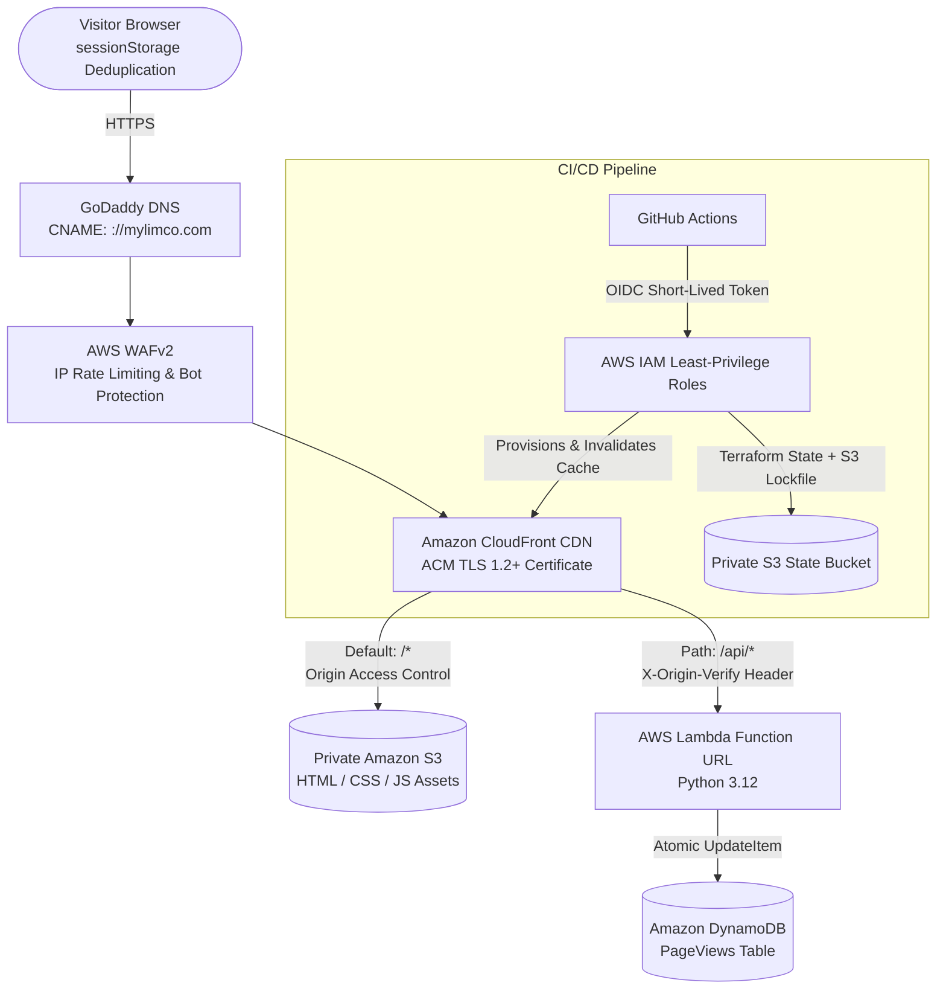

# Serverless Cloud Resume & Static Website on AWS

A production-grade, serverless static website hosted on **Amazon S3**, delivered globally via **Amazon CloudFront** with a custom **GoDaddy** domain and **AWS Certificate Manager (ACM)** SSL/TLS, and backed by a real-time visitor counter powered by **Python**, **AWS Lambda**, and **Amazon DynamoDB**.

Entirely provisioned via **Terraform** and automated using **GitHub Actions CI/CD** with **keyless AWS OIDC authentication**.

---

## 🏗 Architecture Diagram



---

## ✨ Key Features

### Frontend & Global Content Delivery
* **Private S3 Static Hosting:** Website assets (`HTML`, `CSS`, `JS`) are stored in a locked-down S3 bucket with all public access blocked.
* **Automated Asset Sync & MIME Typing:** Terraform scans the `website/` directory using `fileset()`, assigns proper `Content-Type` headers (`text/html`, `text/css`, etc.), and detects file updates via MD5 `etag` checksums.
* **CloudFront CDN & Auto-Invalidation:** Serves assets globally over HTTPS using Origin Access Control (OAC) and automatically triggers cache invalidations (`/*`) when frontend files change.
* **Custom Domain & Managed SSL:** Integrates an external **GoDaddy** subdomain (`://mylimco.com`) secured with a free **AWS Certificate Manager (ACM)** certificate.

### Serverless Backend & Database
* **Serverless API (`counter.py`):** Python 3.12 Lambda function exposed via an HTTPS Function URL—eliminating the need for API Gateway.
* **Atomic View Counter:** Uses **Amazon DynamoDB** (`PAY_PER_REQUEST` on-demand billing) with atomic `UpdateItem` (`if_not_exists`) expressions to prevent race conditions under concurrent traffic.
* **Same-Origin Routing:** Routes `/api/*` requests through CloudFront directly to Lambda with caching disabled (`Managed-CachingDisabled`).

### Multi-Layered Security
* **Browser Deduplication:** Uses `sessionStorage` in client-side JavaScript so repeated page refreshes within a single browser tab session do not inflate view counts.
* **Edge Bot & Flood Protection (AWS WAFv2):** Blocks abusive IP addresses exceeding 100 requests per 5 minutes and filters known malicious IPs via AWS Managed Reputation Lists.
* **Origin Verify Secret Header:** CloudFront injects a 32-character `X-Origin-Verify` header validated in Python via constant-time comparison (`hmac.compare_digest`), rejecting direct calls to the underlying Lambda Function URL (`403 Forbidden`).

### Infrastructure as Code & CI/CD
* **Terraform Remote State & Native Locking:** Stores state securely in a private S3 bucket using native S3 lockfiles (`use_lockfile = true`).
* **Keyless GitHub OIDC Authentication:** Eliminates long-lived static AWS access keys in GitHub Secrets.
* **Branch-Separated Workflows & PR Previews:**
  * **Pull Requests:** Authenticate via a read-only IAM role (`AWS_PLAN_ROLE_ARN`), run `terraform fmt`, `terraform validate`, and `py_compile`, and post the `terraform plan` diff directly as a PR comment.
  * **Main Branch Merges:** Authenticate via a branch-locked deploy role (`AWS_DEPLOY_ROLE_ARN`) scoped with a least-privilege IAM policy to apply changes to production.

---

## 📂 Project Structure

```text
├── .github/
│   └── workflows/
│       └── deploy.yml      # GitHub Actions CI/CD (PR Plan Preview + Main Auto-Deploy)
├── website/
│   ├── index.html          # Main frontend webpage with sessionStorage view counter
│   └── css/
│       └── style.css       # Stylesheet
├── counter.py              # AWS Lambda Python handler & DynamoDB atomic counter
├── main.tf                 # Full AWS infrastructure (S3, CloudFront, WAF, ACM, Lambda, DynamoDB)
└── .gitignore              # Excludes local state, .terraform cache, and zip artifacts
```

---

## 🚀 Deployment Guide

### Prerequisites
1. **AWS Account** with an S3 bucket created in `us-east-1` for Terraform remote state.
2. **GitHub OIDC Provider & IAM Roles** configured with `AWS_PLAN_ROLE_ARN` and `AWS_DEPLOY_ROLE_ARN` stored in GitHub Repository Secrets.
3. **Custom Domain** registered on GoDaddy.

### Initial Setup
1. Update the backend bucket name and `domain_name` variable in `main.tf`.
2. Push changes to `main` (or run `terraform apply` locally).
3. When Terraform pauses at `aws_acm_certificate_validation`, copy the validation **CNAME** record from **AWS Certificate Manager (`us-east-1`)** into your **GoDaddy DNS Management** settings.
4. Once ACM issues the certificate and CloudFront finishes deploying, add the final `www` CNAME record pointing to your `*.cloudfront.net` domain in GoDaddy.
